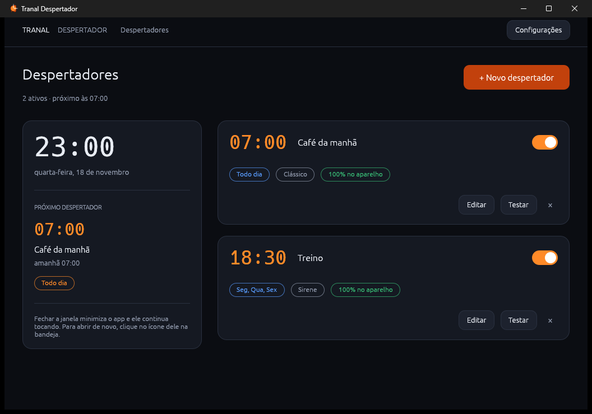

# Tranal Despertador

Despertador desktop para **Windows 10/11**, escrito em **Rust**. Interface dark,
feita para ser usada em um clique, e leve: o binário é nativo (sem navegador
embarcado) e o agendamento **dorme** até o próximo evento.



## O que ele faz

- **Criar despertadores**: uma vez, todo dia, dias úteis (seg–sex) ou nos dias
  marcados da semana.
- **Digitar o horário** por cima do relógio (`0730`, `07:30` e `730` valem
  07:30) — os botões de ±1 h / ±5 min continuam lá para quem preferir.
- **Som**: cinco presets sintetizados pelo próprio app **ou um arquivo do
  dono** — WAV, MP3, FLAC e OGG. O arquivo é **copiado** para a pasta do app,
  então o despertador continua tocando mesmo que o original seja movido.
- **Volume** de 0 a 100 com fade-in progressivo e a opção de forçar 100% na
  saída do Windows enquanto toca.
- **Onde tocar**: escolher uma ou várias saídas de áudio. Sem escolha, toca na
  **saída padrão do Windows**.
- **Como desligar**: Parar, Soneca (com minutos e limite) ou desafio (digitar
  uma palavra / resolver uma conta).
- **Despertador padrão**: nas Configurações, monte um modelo que já vem
  preenchido quando você clica em “Novo despertador”.
- **Continua tocando com a janela fechada** (a janela minimiza; o app segue
  rodando).
- **Fica na bandeja do Windows**: o ícone do despertador laranja fica na área
  de notificação (o app se promove sozinho — o Windows 11 esconde ícone
  novo). Clique esquerdo abre a janela; clique direito abre o menu
  (“Abrir o Tranal” / “Sair”).
- **Instalador e atualização automática**: um `Setup.exe` instala o app, cria
  os atalhos e liga o início automático; o app se atualiza sozinho a cada
  release.
- **Interface com respiro**: nada encosta na borda da janela. A página tem
  32 px de margem, os cartões têm 20 px de respiro interno e a ação
  principal (“+ Novo despertador”) fica na linha do título da página. O
  layout segue a referência do **Tranal Sentinel** (cards com `Padding 20`,
  hierarquia H1/Hero/Label/Sub, números em monoespaçada), com a paleta laranja
  do app, que já passa na WCAG AA.
- **Cartão do despertador em três linhas**: a hora com o nome e o
  interruptor, as etiquetas (“Todo dia”, o som, “100% no aparelho”, o
  desafio) e os botões de ação (“Repetir amanhã”, “Editar”, “Testar”, “×”)
  — cada grupo na sua linha, sem nada por cima de nada.
- **Contraste medido por teste**: um teste do próprio app calcula a razão de
  contraste de **todos** os pares de cor em uso (texto ≥ 4,5:1 e borda de
  etiqueta ≥ 3:1, como manda a WCAG AA). Ele já pegou uma violação real — o
  *hover* do botão principal, que estava em 4,14:1 — e o laranja foi
  ajustado para 4,70:1.

## Instalar

Baixe o **`Tranal-Despertador-Setup.exe`** da
[release mais nova](https://github.com/Matheus-araujo-dev/tranal-despertador/releases/latest)
e rode. Um arquivo só: o app vai dentro dele.

O instalador (Inno Setup) segue o padrão de todos os apps Tranal
(`DEC-APPS-DISTRIBUICAO-001`). A instalação é **por usuário** (não pede
administrador):

| | |
|---|---|
| Programa | `{autopf}\Tranal Group\Tranal Despertador` = `%LOCALAPPDATA%\Programs\Tranal Group\Tranal Despertador` |
| Atalho | Menu Iniciar e Área de trabalho |
| Início automático | ligado numa instalação nova, com o app já minimizado (depois, vale a opção da tela) |
| Dados do dono | `%APPDATA%\Tranal Despertador` — **preservados** na atualização e na desinstalação |

Desinstalar: pelo Windows (Configurações → Aplicativos) ou
`.\scripts\instalar.ps1 -Desinstalar`. Os despertadores e os sons ficam.

**Instalação antiga** (a do `scripts\instalar.ps1` antigo, em
`%LOCALAPPDATA%\Programs\Tranal Despertador`, v0.4.0 ou anterior): o
atualizador dela não consegue se trocar sozinho (o exe em uso fica travado).
Rode o `Tranal-Despertador-Setup.exe` uma vez à mão: ele fecha o app antigo,
apaga a pasta antiga, sobrescreve os atalhos e passa o início automático para
o exe novo. Daí em diante as atualizações são automáticas.

## Publicação e atualização automática

- **Todo PR mesclado na `main` vira uma release.** O workflow
  `.github/workflows/publicar.yml` decide a versão (maior tag `vX.Y.Z` + 1 no
  patch; o `Cargo.toml` é só um piso), grava o número no `Cargo.toml` do
  runner, roda `cargo test`, compila, confere a versão gravada no binário
  (`tranal-despertador.exe --versao`), compila o instalador
  (`iscc /DMyAppVersion=X.Y.Z installer\tranal-despertador.iss`) e cria a tag
  com a release **Latest** e o Setup como asset.
- Para subir minor ou major: aba Actions → **Publicar** → *Run workflow* e
  escolha `patch | minor | major`.
- **O app se atualiza sozinho**: ao abrir e de hora em hora ele lista as
  releases, pega a maior tag `vX.Y.Z` maior que a dele, baixa o Setup,
  confere o tamanho, roda
  `/VERYSILENT /SUPPRESSMSGBOXES /NORESTART /CLOSEAPPLICATIONS` e fecha. O
  Setup reabre o app no fim (escondido na bandeja, se ele estava escondido).
  Nunca no meio de um alarme tocando nem com o editor aberto. Rodando de
  `target\` (desenvolvimento) ele não se atualiza. Log em
  `%LOCALAPPDATA%\Tranal Despertador\update\atualizacao.log`.
- Testar o instalador com o código local: `.\scripts\instalar.ps1` (precisa do
  Inno Setup 6: `winget install JRSoftware.InnoSetup`).

## Como rodar (desenvolvimento)

```powershell
cargo run                 # debug
cargo build --release     # release (target\release\tranal-despertador.exe)
cargo test                # suíte de testes
cargo clippy -- -D warnings
```

O binário é único: não tem servidor, nem banco, nem serviço. Os dados ficam em
`%APPDATA%\Tranal Despertador\dados.json` e os sons em
`%APPDATA%\Tranal Despertador\sons\`.

> O toolchain usado nesta máquina é `x86_64-pc-windows-gnu` (sem MSVC): com
> `rustup default stable-x86_64-pc-windows-gnu` e o MinGW-w64 no `PATH`, o
> `cargo build` funciona sem instalar o Visual Studio.

## Como está organizado

| Módulo | O que faz |
|---|---|
| `src/app.rs` | janela, lista, editor, painel do alarme tocando, configurações |
| `src/ui.rs` | sistema de design: cores, espaçamento, componentes (botões, chip, interruptor, seletor segmentado, slider inteiro) |
| `src/estado.rs` | a **única** cópia do estado, compartilhada entre a interface e o agendador (`Mutex` + `Condvar`) |
| `src/schedule.rs` | cálculo da próxima hora (puro, testável) |
| `src/audio.rs` | reprodução via `cpal` (WASAPI), com fade-in |
| `src/tones.rs` | presets sintetizados e leitura de arquivo (via `symphonia`) |
| `src/arquivos.rs` | seletor de arquivos **dentro do app** (não usa o explorer do Windows) |
| `src/device_volume.rs` | volume do aparelho (Core Audio) e início automático com o Windows |
| `src/tray.rs` | ícone na bandeja do Windows, promoção automática e o clique que reabre a janela |
| `src/tray_menu.rs` | o menu de contexto da bandeja (nativo do Windows, ancorado acima da barra de tarefas) |
| `src/icone.rs` | o desenho do despertador laranja (bandeja, barra de título e `.ico` dos atalhos) |
| `src/model.rs` | modelo de dados (JSON legível) |
| `src/hora.rs` | interpretação do horário digitado |

Decisões estruturais, com o porquê de cada escolha: [`docs/SPEC.md`](docs/SPEC.md).
Índice das decisões do dono: [`docs/decisoes/README.md`](docs/decisoes/README.md).

## Licenças

O app é do dono e o repositório é **privado**. As dependências foram auditadas
com `cargo metadata` (**357** pacotes no grafo completo, **140** no binário do
Windows):

| Licença | Quem usa |
|---|---|
| MIT, Apache-2.0, BSD-2/3, ISC, Zlib, 0BSD, Unlicense | o grosso: `egui`, `eframe`, `winit`, `cpal`, `windows`, `serde`, `chrono`, `dirs`, `winreg`… |
| **MPL-2.0** (copyleft de arquivo) | **symphonia** e suas crates (`symphonia-core`, `symphonia-common`, `symphonia-metadata`, `symphonia-bundle-mp3/flac`, `symphonia-codec-pcm`, `symphonia-format-ogg/riff`) — usada só para **ler** WAV/MP3/FLAC/OGG |
| MIT / Apache-2.0 / OFL-1.1 / Ubuntu-font-1.0 | `epaint_default_fonts` (as fontes padrão do egui) |
| BSL-1.0 | `clipboard-win`, `error-code` |
| Unicode-3.0 | `unicode-ident`, `unicode-properties` |
| **Apache-2.0 OU GPL-2.0-only** (dupla) | `self_cell` — o app usa a opção **Apache-2.0**, a permissiva |
| MIT OU Apache-2.0 OU LGPL-2.1-or-later | `r-efi` — entra só como *build-dependency* do `cc`, ou seja, **fora do processo** do app, e sob a opção permissiva |

**Nada GPL/AGPL no processo** (regra D012 do `AGENTS.md`): nenhuma crate é
GPL-only nem AGPL, e as duas opções dupla/licença copyleft acima são consumidas
sob a opção permissiva.

O que a MPL-2.0 do symphonia exige, na prática: se o **arquivo-fonte do
symphonia** for modificado, essas modificações precisam ser publicadas. O
app não modifica o symphonia — só o usa como biblioteca. O código-fonte do
symphonia vem junto no crate (e no `Cargo.lock` deste repositório).

## Regras do repositório

Leia o [`AGENTS.md`](AGENTS.md) antes de mexer: branch sempre (nunca commitar
direto na `main`), PR para revisão, `cargo test` obrigatório e
`cargo clippy -- -D warnings` limpo.
